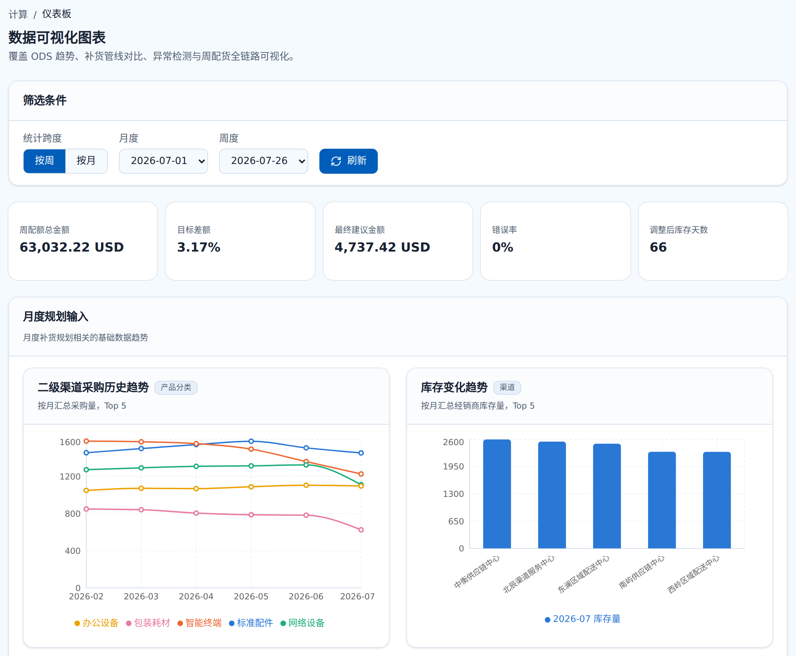
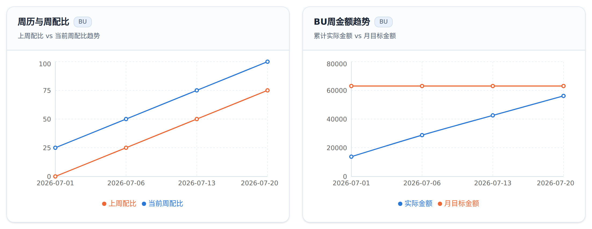
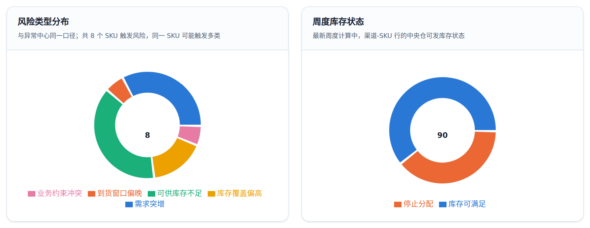
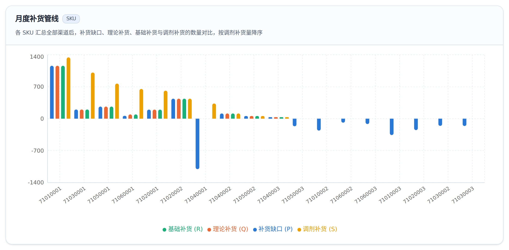
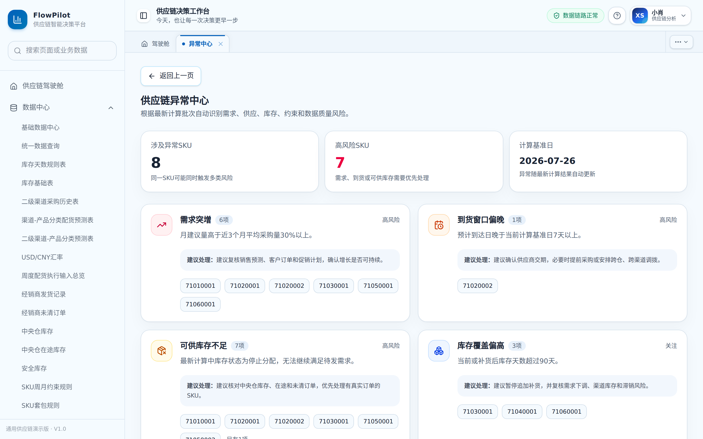
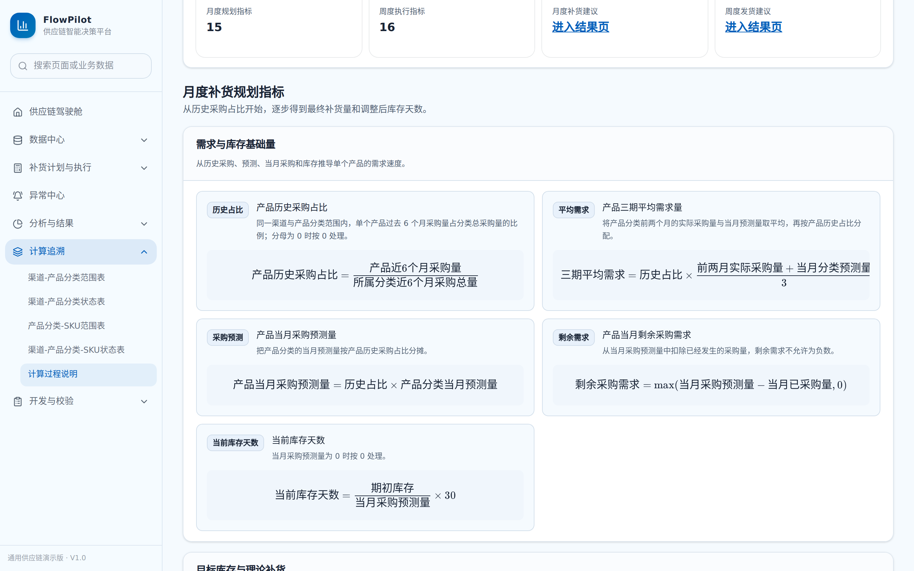
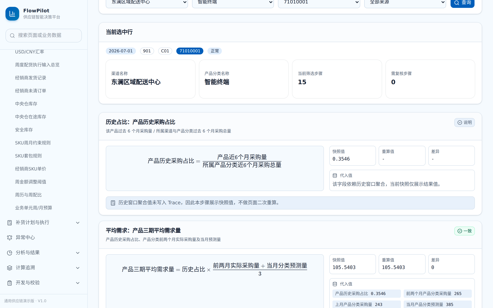
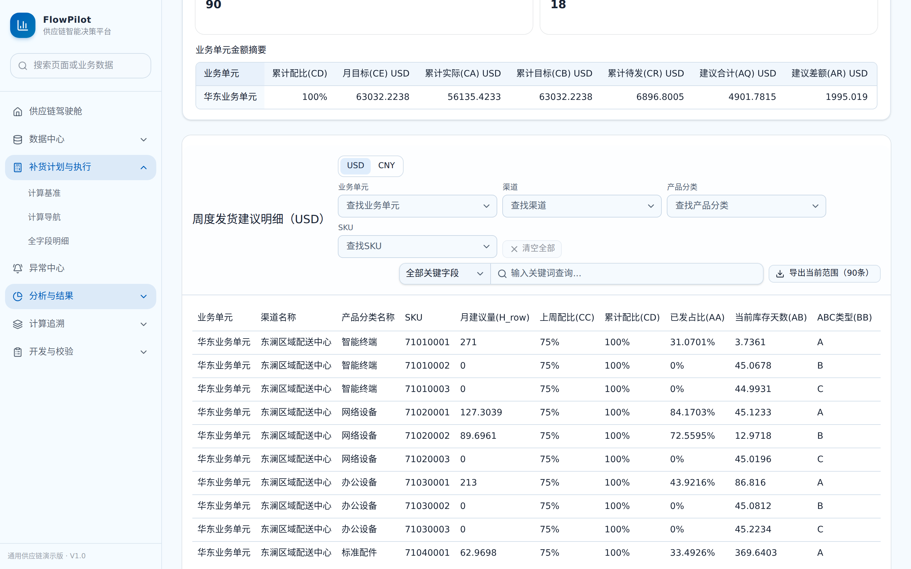

# FlowPilot Lab — Supply Chain Planning & Decision Platform

**See the supply chain first, then act: every replenishment decision backed by data you can trace.**

FlowPilot Lab is a full-stack demo platform for supply chain planning and fulfilment. It connects master data, demand forecasts, inventory, in-transit stock and open orders into one calculation chain. The chain runs from monthly replenishment planning through weekly shipment execution to exception analysis, and every number on screen can be traced back to its formula and inputs.

[中文说明 ↓](#中文说明)


---

## The problem

Replenishment planning often lives in a chain of spreadsheets: purchase history in one file, forecasts in another, inventory and open orders in a third. Planners copy numbers between them by hand. When a suggested quantity looks wrong, nobody can easily tell which input or which step caused it. Risks such as a demand surge or a late shipment are only noticed after they hurt. FlowPilot Lab turns that chain into explicit, traceable calculation stages and surfaces risks automatically.

## Highlights

| | What it does | Why it matters |
|---|---|---|
| **Unified data center** | 20+ input tables (inventory, purchase history, forecasts, in-transit, open orders, prices, safety stock, constraints, calendars, budgets) with combined filters, cross-table query, and Excel template download, import and export. | One source of truth instead of scattered spreadsheets. |
| **Monthly replenishment planning** | Turns purchase history, forecasts, target inventory days and quotas into suggestions in four stages: *replenishment gap → theoretical → base → tolerance-adjusted*. | Each stage has a clear business meaning, so a planner can see where a number came from. |
| **Weekly shipment execution** | Combines central stock, in-transit, open orders, weekly amount targets and business constraints in four stages: *suggested → over-limit reduction → shortfall top-up → final shipment*. | Shipments respect both available stock and the budget. |
| **Exception center** | Six rules flag demand surges, late arrivals, insufficient available stock, excess inventory coverage, constraint conflicts and data-quality gaps. Each rule comes with a suggested action and the affected SKUs. | Risks surface before they turn into stock-outs or overstock. |
| **Calculation traceability** | Every formula is shown in business language. For any channel–category–SKU row, a step-by-step trace shows the inputs, the snapshot value, a recomputed value and the difference. | Results can be verified and explained, not just trusted. |
| **Analytics dashboard** | KPIs for weekly target, gap and final amount; trends for purchases, inventory, forecasts, deliveries and in-transit stock; per-SKU monthly and weekly pipelines; risk-type and inventory-status distributions. Month/week filters. | Planners see patterns and where quantities change, not just tables. |
| **Workspace** | Supply chain cockpit, multi-tab workspace and global page search. | Fast switching between data, results and traces. |

## Screenshots

### Analytics dashboard



| Weekly amount vs monthly target | Risk types and weekly inventory status |
|---|---|
|  |  |



### Exceptions, formulas and traceability

| Exception center | Calculation formulas |
|---|---|
|  |  |
| **Per-SKU calculation trace** | **Weekly shipment suggestions** |
|  |  |

## Tech stack

- **Next.js 16** (App Router) · **React 19** · **TypeScript**
- **Tailwind CSS v4**, Recharts, Lucide icons, KaTeX for formula rendering
- **Prisma ORM** + **PostgreSQL**
- **ExcelJS** + **JSZip** for import and export, **decimal.js** for precise calculation, **zod** for validation

## Getting started

Requires **Node.js 20+**, **PostgreSQL 14+** and npm.

```bash
git clone https://github.com/xiaoyixuan0308-cyber/flowpilot-lab.git
cd flowpilot-lab
npm install
cp .env.example .env          # Windows PowerShell: Copy-Item .env.example .env
```

Fill in your local database settings in `.env`:

```env
DB_HOST="localhost"
DB_PORT="5432"
DB_NAME="flowpilot_lab"
DB_SCHEMA="poc"
DB_USER="postgres"
DB_PASSWORD="your_password"
```

Create the schema and start the app:

```bash
npx prisma generate
npx prisma db push
npm run dev
```

Open http://localhost:3011.

### Demo data

The repo ships a fixed demo workbook covering **5 channels, 6 product categories and 18 SKUs**, with monthly history, weekly execution data, inventory, in-transit stock, orders, prices, constraints and exception scenarios. The standard calculation date is `2026-07-26`.

- On first load the app checks the required input and result tables.
- If the database is empty or key tables are missing, it imports the fixed data and runs the calculation automatically.
- If the data is already complete, nothing is re-imported or overwritten.

```bash
npm run demo:audit                                                  # check demo data coverage
curl -X POST http://localhost:3011/api/data/restore-standard-demo   # restore the standard demo data
```

### Common commands

```bash
npm run dev          # start the development server
npm run build        # production build
npm run start        # start the production build
npm run lint         # lint
npm run demo:audit   # check demo data coverage
```

## Project structure

```
src/app/             pages and API routes
src/components/      UI, tables, charts and formula components
src/server/          data access, import/export and calculation services
prisma/              data model
demo-data/           fixed demo workbook
scripts/             validation and maintenance scripts
docs/screenshots     images used in this README
```

## How it was built

This project grew out of my supply chain internship experience. I wanted to see whether a replenishment process usually managed in spreadsheets could become a clear, verifiable system. I broke the process into field definitions, business rules and page requirements; built and validated the demo data and exception scenarios; and checked results by recomputing samples against the formulas, which found and fixed calculation issues. Later I renamed every internal code to generic supply chain terms and verified that the full calculation chain produced identical results before and after the change.

## Notes

- All names, codes and business data are **fictional demo data**.
- `.env`, build output, dependencies and local logs are not committed. Never put production database addresses, real passwords, tokens or customer data in the code.

## License

For personal learning, portfolio and technical exchange purposes.

---

## 中文说明

**FlowPilot Lab：供应链计划与决策平台。让供应链先看见，再行动，每一次补货决策都有据可查。**

FlowPilot Lab 是一个面向供应链计划与履约场景的全栈演示平台。它把主数据、需求预测、库存、在途和未清订单串成一条计算链路：从月度补货规划、周度配货执行，到异常分析。页面上的每个数字都能追溯到它的公式和输入。

### 解决的问题

补货计划常常依赖一串电子表格：采购历史一份、预测一份、库存和订单又一份，计划员在表格之间手工搬数。当某个建议量看起来不对时，很难判断是哪个输入、哪一步出了问题；需求突增、到货延迟这类风险，往往在造成影响后才被发现。FlowPilot Lab 把这条链路拆成明确、可追溯的计算阶段，并自动识别风险。

### 主要功能

- **统一数据中心**：20 余张输入表（库存、采购历史、预测、在途、未清订单、价格、安全库存、约束、周历、预算），支持组合筛选、跨表查询，以及 Excel 模板下载、导入和导出。
- **月度补货规划**：结合采购历史、需求预测、目标库存天数和配额，分四个阶段生成建议：补货缺口 → 理论补货 → 基础补货 → 调剂补货。
- **周度配货执行**：综合中央仓库存、在途、未清订单、周金额目标和业务约束，分四个阶段形成发货建议：建议补货 → 缩减调整 → 金额补差 → 最终发货。
- **异常中心**：6 条规则识别需求突增、到货偏晚、可供库存不足、库存覆盖偏高、约束冲突和数据质量问题，每类异常都附带建议处理方式和涉及的 SKU。
- **计算追溯**：所有公式都用业务语言展示；任选一个渠道-产品分类-SKU，都能逐步查看输入值、快照值、重算值和差异。
- **数据可视化看板**：周目标金额、目标差额、最终建议金额等 KPI；采购、库存、预测、发货和在途趋势；按 SKU 汇总的月度和周度补货管线；风险类型和库存状态分布。支持按月、按周筛选。
- **工作台**：供应链驾驶舱、多页签工作区和全局页面搜索。

### 本地运行

需要 **Node.js 20+**、**PostgreSQL 14+** 和 npm：

```bash
git clone https://github.com/xiaoyixuan0308-cyber/flowpilot-lab.git
cd flowpilot-lab
npm install
cp .env.example .env          # Windows PowerShell：Copy-Item .env.example .env
# 在 .env 中填写本地数据库信息（字段见上方英文部分）
npx prisma generate
npx prisma db push
npm run dev
```

打开 http://localhost:3011。首次打开时，如果数据库为空，系统会自动导入内置演示数据并完成计算；数据已完整时不会重复导入。演示数据覆盖 **5 个渠道、6 个产品分类、18 个 SKU**，标准计算基准日为 `2026-07-26`。运行 `npm run demo:audit` 可检查数据覆盖情况。

### 开发方式

这个项目源自我的供应链相关实习经历：我想验证一套通常靠电子表格管理的补货流程，能否变成清晰、可验证的系统。我把业务流程拆分为字段定义、业务规则和页面需求，构造并校验了演示数据和异常场景，并通过抽样复算核对计算结果，发现并修正了计算问题。之后把所有内部编码统一改为通用的供应链术语，并逐字段比对，确认改名前后整条计算链路的结果完全一致。

### 说明

- 所有名称、编码和业务数据均为**虚构的演示数据**。
- `.env`、构建产物、依赖目录和本地日志不会提交到版本库；请勿将生产数据库地址、真实密码、访问令牌或客户数据写入代码。
- 本项目用于个人学习、作品展示与技术交流。
