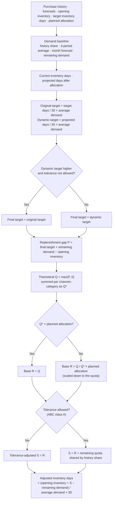
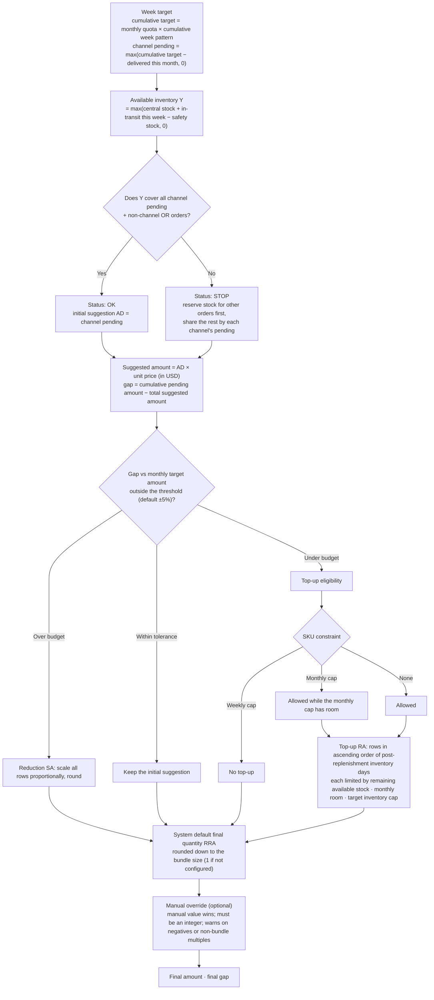

# FlowPilot Lab — Calculation Logic

[中文版](calculation-logic.zh-CN.md)

> This document describes the full rules for monthly replenishment planning, weekly shipment execution and exception detection. The diagram in the README is an overview; this expands every stage's formulas, branches and constraints.
> Every intermediate field is written to the calculation trace. For any channel–category–SKU row, the app shows the inputs, the snapshot value, a recomputed value and the difference.

## 1. Granularity and scope

- **Monthly**: calculated row by row for channel × category × SKU; quotas are controlled at channel × category level.
- **Weekly**: calculated for business unit × channel × SKU; shared resources such as stock and in-transit are pooled per SKU; amount targets are controlled per business unit.
- Before calculating, the valid scope is resolved: which channel–category and category–SKU combinations are active. Combinations outside the scope are skipped and their reason is recorded in the status tables.
- The monthly result feeds the weekly calculation: weekly uses the monthly suggestion as each row's **monthly quota**.

## 2. Monthly replenishment planning

### 2.1 Key formulas

| Field | Formula | Notes |
|---|---|---|
| History share | SKU purchases over the last 6 months ÷ its category's purchases over the last 6 months | 0 when the denominator is 0 |
| 3-period average demand | history share × (actual purchases of the previous two months + category forecast this month) ÷ 3 | |
| Month forecast | history share × category forecast this month | Splits the category forecast down to SKU |
| Remaining demand | max(month forecast − purchased so far this month, 0) | |
| Current inventory days | opening inventory ÷ month forecast × 30 | 0 when the forecast is 0 |
| Projected days after allocation | (category inventory + planned allocation − category remaining demand) ÷ category average demand × 30 | Calculated per channel–category |
| Replenishment gap P | final target + remaining demand − opening inventory | Can be negative, meaning overstock |
| Theoretical Q | max(P, 0) | |
| Base R | Q when Q* is below the planned allocation; otherwise the allocation shared in proportion to Q / Q* | Never exceeds the quota |
| Tolerance-adjusted S | R when tolerance is not allowed; otherwise the unused quota is shared among eligible SKUs by history share | Only ABC class A SKUs are eligible |

### 2.2 Validation (error codes)

The calculation never forces a number out of missing or contradictory data. It flags the row with an error code instead:

| Error code | Meaning |
|---|---|
| `HAS_FCST_CATEGORY_NO_HISTORY` | The category has a forecast but no purchase history, so it cannot be split to SKU |
| `NO_FCST_CATEGORY_NO_HISTORY` | The category has neither forecast nor history |
| `SKU_M0_ZERO` | The SKU's forecast for this month is 0 |
| `CURRENT_DIOH_LT_30_NEED_REPLENISH` | Inventory days are still below 30 after replenishment |
| `CATEGORY_ALLOCATE_MISMATCH` | SKU results summed by category do not equal the category quota |

## 3. Weekly shipment execution

### 3.1 Key rules

**Week target**
- Cumulative target = monthly quota × cumulative week pattern up to this week.
- Channel pending = max(cumulative target − delivered to the channel this month, 0). An over-delivered channel never gets a negative pending quantity.
- Only primary-channel deliveries, open orders and prices count for the channel figures. Both the system code `CHANNEL` and the business label "一级渠道" (primary channel) are recognised.

**Available inventory and status**
- Available inventory = central warehouse stock + in-transit arriving this week − safety stock, never below 0. A default applies when no safety stock is recorded.
- If available inventory cannot cover "all channel pending + non-channel OR orders", the SKU is marked **STOP**: stock for other orders is reserved first, and the rest is shared in proportion to each channel's pending quantity.

**Amount control**
- Each business unit can set its own over-budget and under-budget thresholds; both default to 5%.
- Negative gap beyond the threshold: every row is **scaled down proportionally** and rounded.
- Positive gap beyond the threshold: rows go into **top-up**; otherwise the initial suggestion is kept.
- Amounts are calculated in USD. CNY source amounts are converted at the current rate, which keeps a maintenance history.

**Top-up eligibility and order**
- Two kinds of constraints: weekly cap (no top-up) and monthly cap (top-up allowed while the SKU's monthly cap still has room). Both can apply at once; the weekly cap wins.
- Top-up runs in ascending order of post-replenishment inventory days, so the most under-stocked channel goes first. Each row deducts from the shared remaining stock and monthly room as it goes, in a single pass.
- Each row's top-up is limited by remaining available stock, remaining monthly room and the original target inventory, so it never creates overstock.

**Final quantity**
- The system default takes the over-budget, under-budget or within-tolerance branch, then rounds down to the bundle size.
- Planners can override the final quantity. The manual value wins and must be an integer; negatives or non-bundle multiples raise a soft warning instead of blocking the save.
- Final gap = target pending amount − total final amount.

## 4. Exception detection

The exception center, the cockpit's SKU health and the dashboard's risk distribution all use the same rules on the latest weekly calculation:

| Risk type | Rule | Level |
|---|---|---|
| Demand surge | Monthly suggestion > 3-month average purchases × 1.3 | High |
| Late arrival | In-transit expected arrival > calculation date + 7 days | High |
| Insufficient stock | Inventory status is STOP | High |
| Excess coverage | Current or post-replenishment inventory days > 90 | Watch |
| Constraint conflict | A constraint is configured and top-up is not allowed | Watch |
| Missing master data | Unit price or safety stock is missing | Watch |

One SKU can trigger several risk types; "SKUs with exceptions" counts each SKU once. SKU health = SKUs with no risk ÷ all managed SKUs.

## 5. How results are verified

- **Calculation trace**: each step shows its formula, inputs and snapshot value, then recomputes it from those inputs and shows the difference. A difference of 0 means the step is reproducible.
- **Demo data audit**: `npm run demo:audit` checks coverage of every input and result table.
- **Regression comparison**: after a large refactor, all input and result tables are exported before and after the change and compared field by field. When the internal codes were renamed, all 31 tables and 2,267 rows matched exactly.
