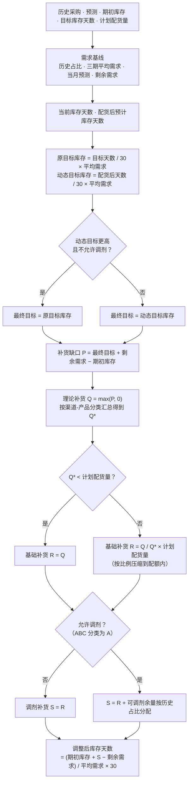
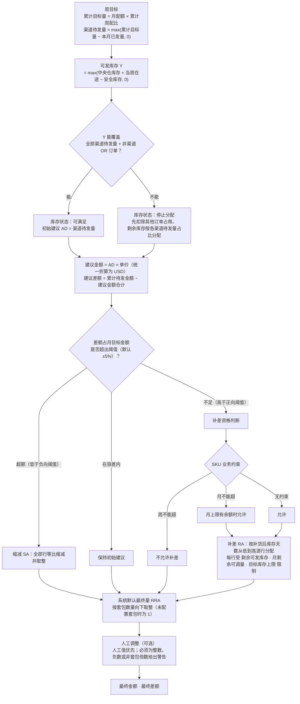

# FlowPilot Lab 计算逻辑详细说明

[English](calculation-logic.md)

> 本文档说明月度补货规划、周度配货执行和异常识别的完整计算规则。README 中的链路图是概览，这里展开每个阶段的公式、分支和约束。
> 所有中间字段都会写入计算追溯：页面上可以对任意一行"渠道-产品分类-SKU"查看输入值、快照值、重算值和差异。

## 1. 计算粒度与数据范围

- **月度**：按"渠道 × 产品分类 × SKU"逐行计算，配额在"渠道 × 产品分类"层面控制。
- **周度**：按"业务单元 × 渠道 × SKU"逐行计算；库存、在途等共享资源在 SKU 层面汇总；金额目标在业务单元层面控制。
- 计算前先确定有效范围：哪些渠道-产品分类、哪些产品分类-SKU 处于有效状态。范围外的组合不参与计算，并在状态表中记录原因。
- 月度结果是周度的输入：周度用月度给出的月建议量作为"月配额"。

## 2. 月度补货规划

### 2.1 主要公式

| 字段 | 公式 | 说明 |
|---|---|---|
| 历史采购占比 | 该 SKU 近 6 个月采购量 ÷ 所属产品分类近 6 个月采购总量 | 分母为 0 时取 0 |
| 三期平均需求 | 历史占比 × (前两个月实际采购量 + 当月分类预测量) ÷ 3 | |
| 当月采购预测 | 历史占比 × 产品分类当月预测量 | 把分类预测拆到 SKU |
| 当月剩余需求 | max(当月预测 − 当月已采购, 0) | |
| 当前库存天数 | 期初库存 ÷ 当月预测 × 30 | 预测为 0 时取 0 |
| 配货后预计库存天数 | (分类库存 + 计划配货量 − 分类剩余需求) ÷ 分类平均需求 × 30 | 按渠道-产品分类汇总计算 |
| 补货缺口 P | 最终目标库存 + 当月剩余需求 − 期初库存 | 可以为负，表示库存偏高 |
| 理论补货 Q | max(P, 0) | |
| 基础补货 R | Q* 小于计划配货量时取 Q；否则按 Q 占 Q* 的比例分配计划配货量 | 保证不超过配额 |
| 调剂补货 S | 不允许调剂时等于 R；允许时把配额剩余部分按历史占比分给可调剂的 SKU | |

### 2.2 数据校验（错误码）

计算不会对缺失或矛盾的数据"硬算"出一个数字，而是给该行打上错误码：

| 错误码 | 含义 |
|---|---|
| `HAS_FCST_CATEGORY_NO_HISTORY` | 产品分类有预测但没有历史采购，无法拆分到 SKU |
| `NO_FCST_CATEGORY_NO_HISTORY` | 产品分类既没有预测也没有历史，无法参与计算 |
| `SKU_M0_ZERO` | SKU 当月预测为 0 |
| `CURRENT_DIOH_LT_30_NEED_REPLENISH` | 补货后库存天数仍低于 30 天，需要继续补货 |
| `CATEGORY_ALLOCATE_MISMATCH` | 各 SKU 分配结果按产品分类加总，与分类配额不一致 |

## 3. 周度配货执行

### 3.1 关键规则

**周目标**
- 累计目标量 = 月配额 × 截至本周的累计周配比。
- 渠道待发量 = max(累计目标量 − 该渠道本月已发量, 0)。已经超发的渠道不会出现负的待发量。
- 只有一级渠道的发货、未清订单和单价参与渠道口径计算。系统编码 `CHANNEL` 和业务标签"一级渠道"都会被识别。

**可发库存与库存状态**
- 可发库存 = 中央仓库存 + 当周预计到达的在途 − 安全库存，结果不小于 0。安全库存没有记录时使用默认值。
- 如果可发库存覆盖不了"全部渠道待发量 + 非渠道 OR 订单"，该 SKU 判为**停止分配**：先扣除其他订单占用的库存，剩余部分按各渠道待发量的占比分配。

**金额控制**
- 每个业务单元可以分别设置超额阈值和不足阈值，默认都是 5%。
- 建议差额为负，且超出负向阈值时：所有行**等比缩减**并取整。
- 建议差额为正，且超出正向阈值时：进入**补差**，否则保持初始建议。
- 金额以 USD 计算，人民币来源的金额按当前汇率折算，汇率有维护历史。

**补差的资格与顺序**
- 业务约束有两种：周不能超（禁止补差），月不能超（在 SKU 月上限还有余额时允许补差）。两种约束可以同时存在，周不能超优先。
- 补差按"补货后库存天数"从低到高逐行进行，优先补最缺货的渠道。每补一行，就同步扣减共享的剩余可发库存和月剩余可调量，一次扫描完成。
- 每行补差量不超过：剩余可发库存、月剩余可调量，以及原目标期末库存的上限（避免补成积压）。

**最终数量**
- 系统默认最终量按"超额 / 不足 / 容差内"三种情况取值，再按套包数量向下取整。
- 计划员可以人工覆盖最终数量：人工值优先；必须是整数；负数或不是套包倍数时给出软警告，不会直接阻止保存。
- 最终差额 = 目标待发金额 − 最终金额合计。

## 4. 异常识别规则

异常中心、首页健康率和看板上的风险分布，都基于最新一次周度计算结果，使用同一套规则：

| 风险类型 | 判定规则 | 级别 |
|---|---|---|
| 需求突增 | 月建议量 > 近 3 个月平均采购量 × 1.3 | 高风险 |
| 到货窗口偏晚 | 在途预计到达日 > 计算基准日 + 7 天 | 高风险 |
| 可供库存不足 | 库存状态为"停止分配" | 高风险 |
| 库存覆盖偏高 | 补货后或当前库存天数 > 90 天 | 关注 |
| 业务约束冲突 | 配置了业务约束，且不允许补差 | 关注 |
| 基础数据缺失 | 缺少单价或安全库存 | 关注 |

同一个 SKU 可能同时触发多类风险，统计"涉及异常 SKU"时去重。SKU 健康率 = 未触发任何风险的 SKU 数 ÷ 管理中的 SKU 总数。

## 5. 结果校验方式

- **计算追溯**：每一步都展示公式、输入值、快照值，并用页面上的输入重新计算一遍，显示差异。差异为 0 说明这一步的结果可复现。
- **演示数据审计**：`npm run demo:audit` 检查各输入表和结果表的覆盖情况。
- **回归比对**：大范围重构后，导出改动前后的全部输入表和结果表逐字段比对。内部编码统一改名时，31 张表、2,267 行的比对结果完全一致。
